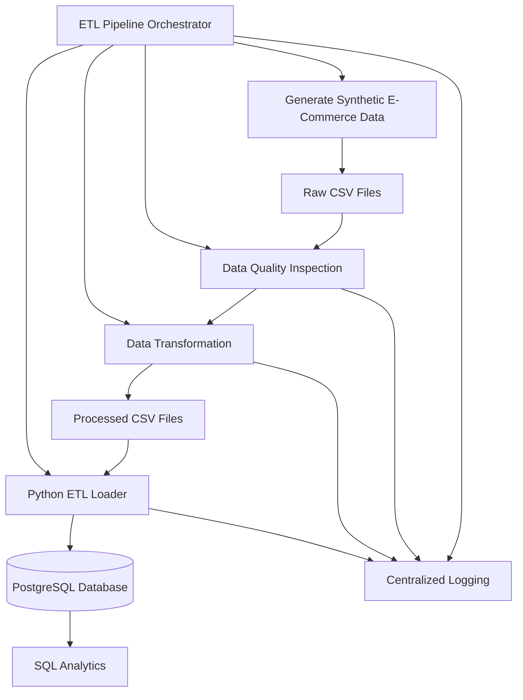

# E-Commerce Sales Data Pipeline — Architecture

## 1. Architecture Diagram



## 2. Pipeline Components

| Component | Responsibility |
|---|---|
| Data Generation | Creates synthetic e-commerce CSV datasets |
| Data Inspection | Checks missing values, duplicates, and invalid records |
| Data Transformation | Cleans data and calculates order-item totals |
| PostgreSQL Loader | Loads processed data into relational tables |
| ETL Orchestrator | Executes pipeline stages in sequence |
| Logging | Records execution details, warnings, and errors |
| SQL Analytics | Performs sales and business analysis |

## 3. Data Storage

**Raw data:** `data/raw/`

**Processed data:** `data/processed/`

**Database schema:** `sql/schema.sql`

**Analytics queries:** `sql/analytics.sql`

**Execution logs:** `logs/etl_pipeline.log`

## 4. Database Tables

- customers
- products
- orders
- order_items
- payments

## 5. Execution

Run the complete pipeline from the project root:

```powershell
python -u src/etl_pipeline.py
```

The pipeline generates data, validates it, transforms it, and attempts to load it into PostgreSQL.

The loader safely skips insertion when records already exist, preserving existing database data.
